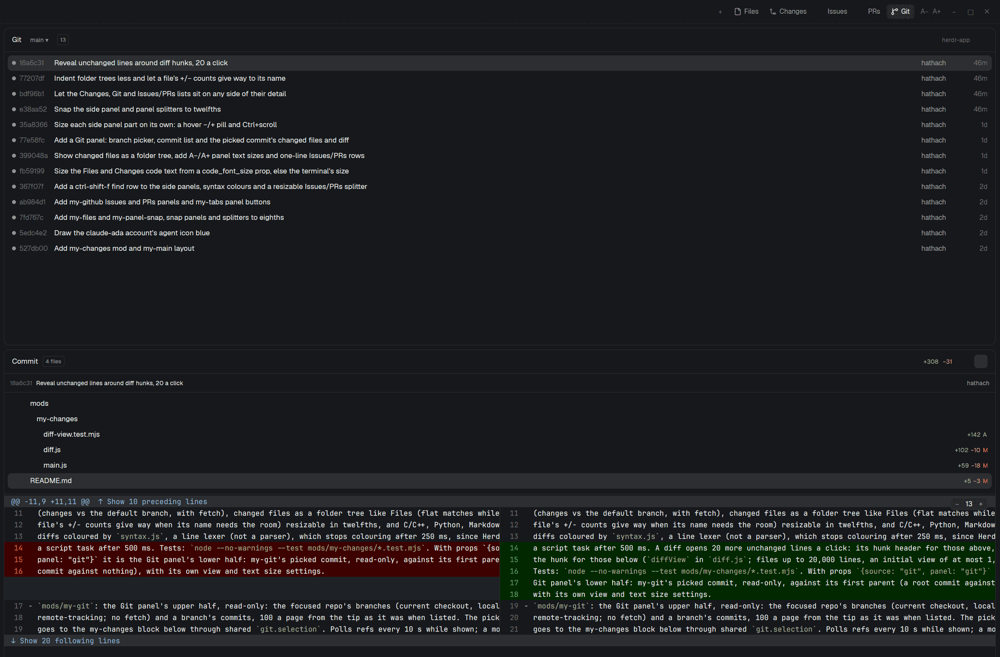

# herdr-app

My customizations for the [Herdr](https://herdr.dev) desktop app, tracked in place in `~/.config/herdr-app`. The
`.gitignore` allowlist keeps Herdr's shipped files and runtime state out: name your own layouts, themes and mods
`my-*` or they stay untracked.



## Features

- [Side panel](#side-panel): Files, Changes, Issues, PRs and Git views from tab-bar buttons.
- [Files](#files): the tree and a file preview together.
- [Changes](#changes): uncommitted or branch changes as a folder tree, side-by-side or unified diffs with syntax
  colours, 20 more unchanged lines per click, a commit box and an open-in-a-pane button.
- [Line selection](#line-selection): select diff lines and copy their reference (`path:L6-L8`) to ask an agent about
  them, or copy their text.
- [Issues and PRs](#issues-and-prs) through `gh`: list, filter, search, detail with comments and checks, comment,
  close/reopen, and the open PR's changed files and diff.
- [Git](#git): a repo's branches and commits, and the picked commit's changed files and diff.
- [Find](#find): one key for every panel, `ctrl-shift-s`.
- [Sizes and placement](#sizes-and-placement): text size per panel and per part of a panel; lists on any side of their
  detail; the side panel and list splitters snap to twelfths.
- [Agents list](#agents-list): each agent's terminal address, a second Claude account's icon in blue, and a Claude
  Code session's background work.
- [Keys](#keys): `ctrl-v` pastes text and copied files in terminals.

## Side panel

`layouts/my-main.json` is Herdr's `main` layout with the tab bar, agents list, Files and Changes pointed at `my-tabs`,
`my-agents`, `my-files` and `my-changes`, plus three panels:

- Issues: `my-github`.
- PRs: `my-github` over `my-changes`, 3:5, resizable.
- Git: `my-git` over `my-changes`, 3:5, resizable.

The side panel is sized by share (default 5/12, no fixed pixel maximum), with `my-panel-snap` in it. `mods/my-tabs` is
Herdr's tab bar plus Issues, PRs and Git buttons for the side panel. The Files and Changes blocks' prop
`code_font_size` (13, the panels' list size) sizes the diff and file preview text, in the terminal's font, at the
default panel text size; without it they use the terminal's size.

### Files

`mods/my-files`: Herdr's Files panel showing the tree and a file preview together, with the tree on any side and
resizable in twelfths. Markdown and reST previews are coloured; they are read-only lines without text selection. Other
files use Herdr's editor.

### Changes

`mods/my-changes`: Herdr's Changes panel plus:

- A scope bar: Uncommitted, or Branch (changes vs the default branch, with fetch).
- Changed files as a folder tree like Files (flat matches while finding; a file's +/− counts give way when its name
  needs the room), resizable in twelfths.
- Side-by-side or unified diffs. C/C++, Python, Markdown and reST diffs are coloured, until colouring takes 250 ms.
- 20 more unchanged lines a click: a hunk's header for those above, a row after the hunk for those below (files up to
  20,000 lines, an initial view of at most 1,500 rows).
- An open-in-a-pane button: the pane stays on this repo instead of following focus.
- A commit box that stages and commits all the repo's changes (`git add -A`), untracked files included, whatever file
  is picked or filter set.

#### Line selection

- Click a diff line to select it, shift-click to extend the range on its side (deleted lines are the old side; side by
  side, the column clicked). Escape or `×` clears.
- `ctrl-shift-c` (Copy reference) copies `path:L6-L8`, or `path@<short sha>:L6-L8` when the lines come from a commit:
  deleted lines, the Git and PRs panels. With no selection it copies the path.
- `ctrl-c` (Copy text) copies the lines without numbers or markers, whole where the view cuts them.
- The bar under the diff shows the reference, the range's size (hidden lines included) and why a copy is off.

### Issues and PRs

`mods/my-github`: Issues and PRs panels for the focused repo through `gh` on the repo's machine: list, filter, search,
detail with comments and PR checks below a list resizable in twelfths, comment, close/reopen behind a confirm. Only
the `upstream` and `origin` remotes count, never other forks: the one picked in the panel, else
`gh repo set-default`'s, else `upstream`, else `origin`; github.com only.

The PRs panel's lower half (my-changes) shows the open pull request's head against its merge base with the base, from
the local clone (renames show as a delete and an add). A head or base not in the clone shows a Fetch button that
fetches exactly those commits from the repo's GitHub remote, objects only (no refs, FETCH_HEAD, tags or commit graph);
a shallow clone, unrelated history, several merge bases or a head already in its base show why there is no
comparison.

### Git

`mods/my-git` is the Git panel's upper half, read-only: the focused repo's branches (current checkout, local,
remote-tracking; no fetch) and a branch's commits, 100 a page from the tip as it was when listed. Polls refs every 10 s
while shown; a moved branch reloads the first page, or offers Reload once more pages are loaded. Reads never fetch a
partial clone's missing objects (`--no-lazy-fetch`; a Git without it shows an error).

The lower half (my-changes) shows the picked commit, read-only, against its first parent (a root commit against
nothing), with its own view and text size settings.

### Find

`ctrl-shift-s` opens the side panel's find row (its shown panel, else Files):

- Files finds a path in the whole repo (tracked and untracked, not ignored; outside a repo, the loaded folders).
- Changes and Git filter changed files.
- Issues and PRs find a loaded number or title (Enter on a number opens it even when it isn't loaded). In the PRs
  panel the key finds pull requests; the PR's changed files have their own find button in the header.

Enter opens the first match, Escape closes the row and returns to the terminal.

### Sizes and placement

- Panel text size: while the side panel is open, the tab bar's A−/A+ size the shown panel's text, 10–20 px at zoom 1,
  default 13; each panel scales its text and rows from its own.
- Part sizes: each part of a panel (Files list and preview; Changes list, diff and commit box; Git commits, changed
  files and diff; Issues and PRs list and detail; PR changed files and diff) shows a `− 13 +` pill while hovered,
  Ctrl+scroll over it resizes it, and clicking the number resets it. A part keeps an offset from its panel's size,
  clamped to 8–24 px at zoom 1, so A−/A+ moves every part with the panel until a part reaches a limit. Below 96 px wide
  the pill drops its number, below 52 px only Ctrl+scroll is left. Resizing a code preview reopens its editor at the
  top. Fenced code blocks in Issues and PRs bodies and comments keep a fixed size: Herdr's Markdown view can't size
  them.
- List sides: like the Files tree, the Changes and Git changed-files list moves to any side of its diff, and the Issues
  and PRs list to any side of an open item, from a header button. Each list remembers its side and, separately, its
  height and width share, so switching sides keeps both sizes; the Changes list's height fits its files until dragged,
  and the commit box stays below both.
- `mods/my-panel-snap` snaps the right side panel to the nearest twelfth of the work area when a drag ends.

## Agents list

`mods/my-agents`: Herdr's agents list with:

- Each agent's terminal address beside its name (`t3s`, or `ci/t7` on another machine: the name `hc` takes); the
  collapsed list shows it in a row's tooltip.
- A second Claude account's icon in the theme's blue: a terminal whose foreground runs as `claude-ada` (the wrapper
  does `exec -a claude-ada claude`). `programs.json` makes `claude-ada` count as Claude Code before its first status
  report.
- Background work: a Claude Code session whose turn ended but still runs background work (shells, Monitors) shows a
  spinner with their count beside its status, and a clock for scheduled prompts; an idle one with background tasks
  sorts with Working. Done keeps meaning a response to read. The counts come from `hooks/claude-background.mjs`, a
  Claude Code hook that labels the session's hc terminal at each Stop; see [Setup](#setup).

## Keys

| Key            | Where                  | Does                                            | Set in      |
|----------------|------------------------|-------------------------------------------------|-------------|
| `ctrl-shift-s` | side panel (`my-main`) | the find row; see [Find](#find)                 | `keys.json` |
| `ctrl-v`       | terminal               | pastes text and copied files (`terminal.paste`) | `keys.json` |
| `ctrl-shift-f` | terminal               | Herdr's terminal search, its default            | `keys.json` |
| `ctrl-c`       | a diff                 | copies the selected lines' text                 | my-changes  |
| `ctrl-shift-c` | a diff                 | copies the selected lines' reference            | my-changes  |
| `escape`       | a diff, a find row     | clears the selection; closes the row            | the panels  |

`settings.json` holds my zoom, terminal font size with ligatures off, and sounds.

## Setup

On another machine:

```sh
cd ~/.config/herdr-app
git init -b main && git remote add origin git@github.com:hathach/herdr-app.git
git fetch origin && git checkout -f -t origin/main   # replaces that machine's keys.json and settings.json
herdr-app do layout.switch '{"name":"my-main"}'
```

The agents list's blue icon expects a `claude-ada` wrapper (`exec -a claude-ada claude`, not in this repo). Register
the background-work hook in each Claude config dir:

```sh
for d in ~/.claude ~/.claude-ada; do python3 - "$d/settings.json" <<'EOF'
import json, sys
path = sys.argv[1]; settings = json.load(open(path))
hook = {"type": "command", "command": "$HOME/.config/herdr-app/hooks/claude-background.mjs", "timeout": 5}
for event, matcher in (("Stop", None), ("SessionStart", "startup|resume"), ("SessionEnd", None)):
    groups = settings.setdefault("hooks", {}).setdefault(event, [])
    if not any(h.get("command") == hook["command"] for g in groups for h in g.get("hooks", [])):
        groups.append({**({"matcher": matcher} if matcher else {}), "hooks": [hook]})
json.dump(settings, open(path, "w"), indent=2)
EOF
done
```

## Tests

```sh
node --no-warnings --test mods/my-*/*.test.mjs hooks/*.test.mjs
for m in mods/my-*/; do herdr-app check "$m"; done
```

## Implementation notes

- Mods can't import each other, so shared helpers are copies kept identical: `syntax.js` in my-files and my-changes
  (checked by the test), `part-math.js` in my-files, my-changes, my-git, my-github and my-tabs, `part-size.js` in the
  first four, `part-split.js` in my-changes and my-github.
- my-changes with props `{source: "git", panel: "git"}` is the Git panel's lower half, reading my-git's pick from shared
  `git.selection`; with `{source: "pr", panel: "prs"}` it is the PRs panel's, reading my-github's open PR from shared
  `pr.selection`, and its list part is `files`.
- Sizes are shared `panel.text_size.<files|changes|issues|prs|git>` and `panel.text_offset.<panel>.<part>` (−12 to
  +14); list sides and shares are `list:<panel|pane|git|pr|issues|prs>[:side|:across]` in each copy's storage.
- `syntax.js` is a line lexer (not a parser); it stops colouring after 250 ms, since Herdr interrupts a script task
  after 500 ms. `diffView` in `diff.js` reveals unchanged lines; `selection.js` holds line selection.
- The hook writes the terminal labels `claude.background_tasks` and `claude.session_crons`, which my-agents reads.
- Herdr's Settings screen can't take extra rows (`frame/` is rewritten on every start), so A−/A+ live in the tab bar.

## License

Apache-2.0, as Herdr. Files cloned from Herdr's shipped mods and layouts are modified copies; each says so and
records its origin in `cloned_from`. Icons copied from Herdr are Lucide glyphs under ISC/MIT: see `LICENSE-Lucide.txt`.
